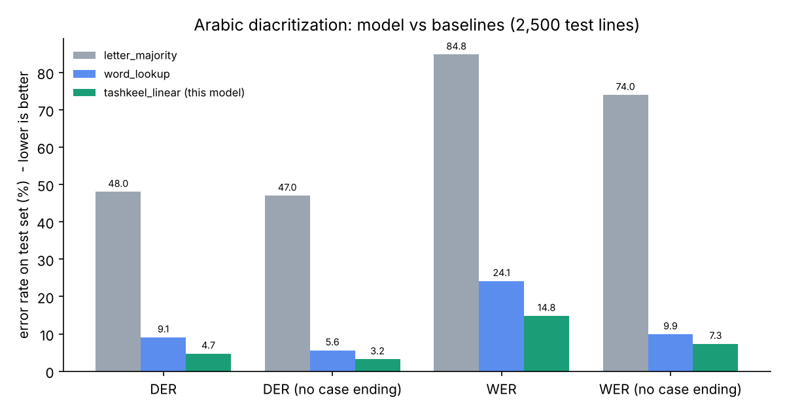

# tashkeel: a small open Arabic diacritization model

`tashkeel` adds the short-vowel marks (harakat: fatha, damma, kasra, sukun, shadda and tanween) to plain Arabic text.

```
input : قوله : ولو ادعى ولد أمة مشتركة ثبت نسبه ، وهي أم ولده
output: قَوْلُهُ : وَلَوْ ادَّعَى وَلَدَ أَمَةٍ مُشْتَرَكَةٍ ثَبَتَ نَسَبُهُ ، وَهِيَ أُمُّ وَلَدِهِ
```

It is a **linear classifier over hashed character and word features**, trained on CPU in about 10 minutes with scikit-learn. The released weights are 7.5 MB, it needs no GPU and no deep-learning framework, and it is fully reproducible from `train.py`.

| Test set (2,500 held-out lines) | DER ↓ | DER (no case ending) ↓ | WER ↓ | WER (no case ending) ↓ |
|---|---|---|---|---|
| Baseline: most frequent mark per letter | 48.02% | 46.99% | 84.79% | 73.96% |
| Baseline: word lookup (memorise each training word) | 9.05% | 5.59% | 24.15% | 9.88% |
| **tashkeel (this model)** | **4.71%** | **3.19%** | **14.81%** | **7.33%** |



See [MODEL_CARD.md](MODEL_CARD.md) for intended use, limitations and licensing.

---

## شرح المشروع بالعربي

**وش يسوي المشروع؟**
هذا نموذج ذكاء اصطناعي صغير ومفتوح المصدر "يشكّل" النص العربي، يعني يحط الحركات (الفتحة والضمة والكسرة والسكون والشدة والتنوين) على الكلمات تلقائياً.

**وش المشكلة اللي يحلها؟ (مثال من الحياة)**
أغلب النصوص العربية تنكتب بدون تشكيل. الإنسان يفهم من السياق إن "علم" ممكن تكون "عِلْم" أو "عَلَم" أو "عَلِمَ"، لكن الكمبيوتر ما يعرف. مثلاً: برنامج يقرأ النص بصوت (تحويل النص لكلام) بيغلط في النطق إذا ما عنده تشكيل، وطالب يتعلم العربية يحتاج النص مشكول عشان يقرأه صح. هذا النموذج يعطيك النص مشكول خلال أجزاء من الثانية.

**كيف يشتغل؟**
1. نعطيه نص عربي بدون حركات.
2. لكل حرف، يشوف الحروف اللي حوله (خمسة قبله وخمسة بعده)، والكلمة كاملة، والكلمة اللي قبلها واللي بعدها.
3. يحسب "درجة" لكل حركة ممكنة (فتحة، ضمة، ...) ويختار الأعلى.
4. يطلع لك النص نفسه بس مع الحركات.

تعلّم هذا من 50 ألف سطر عربي مشكول من كتب التراث (مجموعة بيانات "تشكيلة" المفتوحة).

**كيف أشغله؟**
```bash
pip install -r requirements.txt
python diacritize.py "ذهب الطالب الى المدرسة"
```

**النتيجة الرئيسية:**
على 2,500 سطر ما شافها النموذج أبداً وقت التدريب، غلط في **4.7% فقط من الحروف** (يعني يصيب تقريباً 95 حرف من كل 100). الطريقة البسيطة اللي تحفظ كل كلمة وتشكيلها الأشهر غلطت في 9.1%، يعني نموذجنا قلّل الأخطاء للنص تقريباً. أصعب شي عليه هو حركة آخر الكلمة (الإعراب) لأنها تعتمد على قواعد النحو.

**حدوده بصراحة:** تدرب على نصوص تراثية وفقهية، فأداؤه على النصوص الحديثة (أخبار، تغريدات، لهجات) أضعف، وما يصلح يعتمد عليه في القرآن الكريم أو النصوص اللي تحتاج دقة 100% بدون مراجعة إنسان.

---

## Why it is useful

* Text-to-speech, language-learning apps, dictionaries and search tools all need diacritized Arabic, but most Arabic text is written without marks.
* Most open diacritizers are deep neural networks that need PyTorch/TensorFlow and a GPU to train. This one trains in ~10 minutes on 2 CPU cores with scikit-learn, so it is easy to study, retrain and embed (e.g. as a fast first pass or a baseline for research).
* The code is small and documented: `tashkeel/features.py` shows how to turn Arabic text into features with the hashing trick, fully vectorised in NumPy.

## Install and run

```bash
cd models/arabic-diacritizer
pip install -r requirements.txt

# use the released model
python diacritize.py "العلم نور"
python diacritize.py -i my_text.txt -o my_text_diacritized.txt
```

From Python:

```python
from tashkeel import Diacritizer
model = Diacritizer.load("weights/tashkeel-linear")
print(model.diacritize("ذهب الطالب الى المدرسة"))
```

Retrain from scratch (downloads ~38 MB of text into `data/`, which is git-ignored):

```bash
python train.py            # full run, ~10-12 min on 2 CPU cores; keeps all features in memory, so allow a few GB of RAM
python train.py --quick    # smoke test, ~10 s
pytest -q tests
```

`train.py` writes `weights/tashkeel-linear.{npz,json}` and the reports in `results/`.

## How it works

1. **Labels.** Each Arabic letter gets one label: the marks written on it in canonical order (shadda first). 15 labels occur at least 20 times in training (none, fatha, damma, kasra, sukun, the three tanween, shadda alone and shadda + each vowel/tanween).
2. **Features** (one sparse row per letter, hashed into 2^21 columns): characters at offsets -5..+5; character 2/3/4/5-grams around the letter; the whole word with the letter's position (lets the model memorise frequent words); the previous and next word combined with the current word/letter (case endings depend on neighbours); letter x position x word length.
3. **Classifier.** `SGDClassifier` (hinge loss, averaged weights, L2 = 1e-7), trained for 15 epochs on 8.36 million letters in mini-batches of 5,000 lines. Hash size and epoch count were picked by validation DER over three runs; selection never used the test split.
4. **Constraint.** Tanween is only allowed on the last or second-to-last letter of a word (it sits before a final alef, e.g. رَجُلًا).
5. **Release.** Weights are quantised to int8 with one scale per class (7.5 MB). The reported metrics are computed with the quantised weights, i.e. exactly the released model.

## Data and licences

| Data | Use | Licence |
|---|---|---|
| [AliOsm/arabic-text-diacritization](https://github.com/AliOsm/arabic-text-diacritization) benchmark (Fadel et al., 2019, [arXiv:1905.01965](https://arxiv.org/abs/1905.01965)): 50,000 train / 2,500 val / 2,500 test lines | training and evaluation; downloaded by `tashkeel/data.py`, not committed | MIT |
| Underlying text: [Tashkeela corpus](https://sourceforge.net/projects/tashkeela/) (Zerrouki & Balla, 2017), mostly classical Arabic books | source of the benchmark lines | GPLv2 (per its SourceForge page) |

No raw text is redistributed here; only the trained weights and a few short sample lines in `results/samples.md`. Because the benchmark is derived from a GPLv2 corpus, a cautious user should treat the released weights as covered by GPLv2, or retrain on data with a licence that suits them.

## Results and honest limitations

Full numbers: [results/metrics.md](results/metrics.md) and [results/metrics.json](results/metrics.json); sample outputs: [results/samples.md](results/samples.md).

* **Metric definition.** DER here counts *every* Arabic letter, including letters whose correct label is "no mark"; WER counts a word as wrong if any letter is wrong. Papers on this benchmark often report DER without "no mark" letters, so numbers are not directly comparable. The deep BiLSTM models in the benchmark paper report clearly lower error rates; this model trades accuracy for simplicity and CPU-only training.
* **Case endings are the main weakness:** error drops from 4.71% to 3.19% DER when the last letter of each word is ignored. Damma (13% error), tanween (10-27%) and shadda alone (90%, very rare) are the hardest labels.
* **Domain.** The training text is mostly classical jurisprudence and literature. On modern news, social media or dialects the model is noticeably weaker (e.g. it may give the wrong case ending in short modern sentences). It does not fix spelling (e.g. الى is left unmarked instead of إلى).
* **Not for sacred or high-stakes text without human review**, e.g. Quran text, legal documents or educational material.
* Single training run (seed 0); no confidence intervals were computed.
