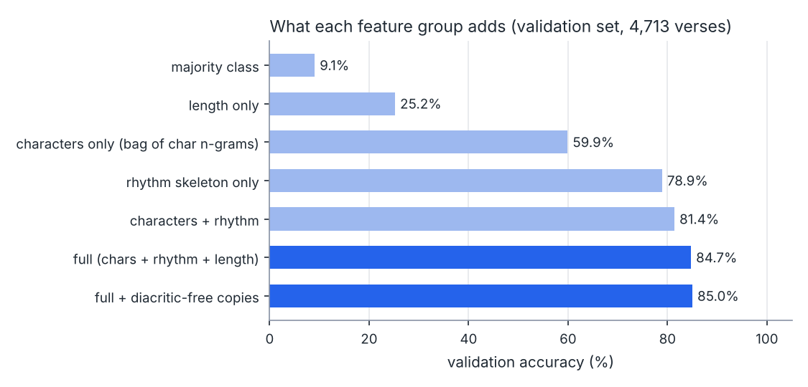
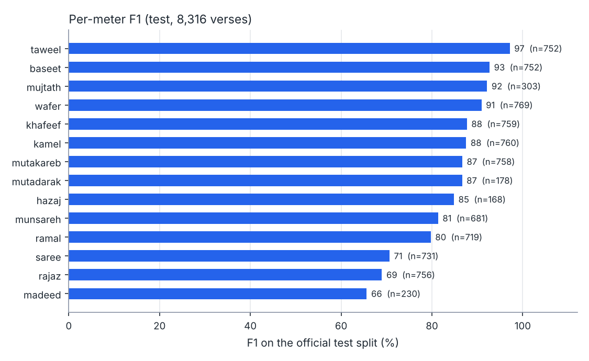
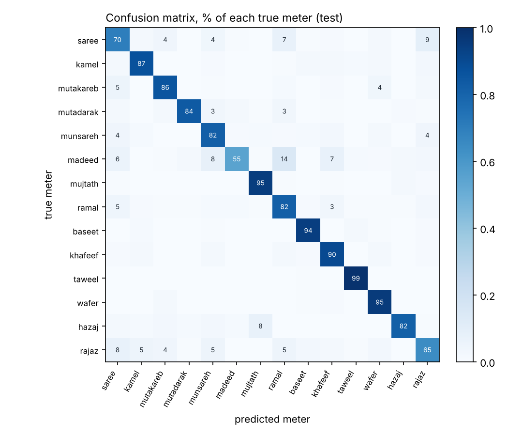
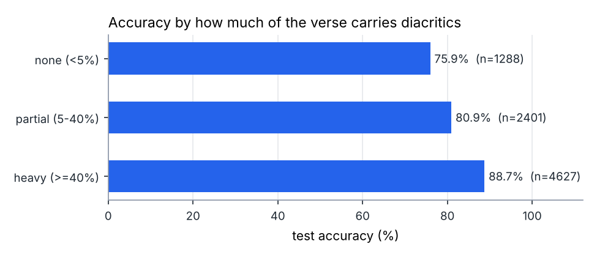

# bahr: an open Arabic poetry meter classifier

`bahr` (بحر, "meter") tells you which of the **14 classical Arabic meters** a verse is
written in, for example al-Taweel (الطويل), al-Baseet (البسيط) or al-Kamel (الكامل).
It is a small, transparent model (linear SVM, 5.7 MB, CPU only, no pickle) trained on
the open **MetRec** dataset, with a clear baseline comparison, ablations and an honest
model card ([MODEL_CARD.md](MODEL_CARD.md)).

```text
$ python predict.py "الخيل والليل والبيداء تعرفني # والسيف والرمح والقرطاس والقلم"
الخيل والليل والبيداء تعرفني # والسيف والرمح والقرطاس والقلم
  1. البسيط (baseet)  score=+1.51
  2. الطويل (taweel)  score=-0.63
  3. المديد (madeed)  score=-0.90
```

---

## شرح المشروع بالعربي

**وش يسوي المشروع؟**
الشعر العربي الفصيح مبني على أوزان اسمها "البحور" (مثل الطويل والبسيط والكامل). معرفة
بحر البيت تحتاج "تقطيع عروضي" وهو شغل دقيق وطويل حتى على طلاب اللغة العربية.
هذا المشروع نموذج ذكاء اصطناعي صغير ومفتوح المصدر: تعطيه بيت شعر، ويقول لك وش بحره،
ويعطيك أقرب ثلاث احتمالات.

**مثال من الحياة اليومية:** طالب في الثانوي أو الجامعة عنده واجب "حدد بحر هذا البيت"،
أو شخص يقرأ قصيدة ويبي يعرف وزنها. يكتب البيت (بتشكيل أو بدونه) ويحط علامة `#` بين
الشطرين، والنموذج يرد عليه: "الأرجح البسيط، وبعده الطويل". بعدها يتأكد بنفسه بالتقطيع.

**كيف يشتغل؟**
1. ندرّبه على حوالي 47 ألف بيت معروف بحرها (بيانات MetRec المفتوحة).
2. الكود يحوّل كل بيت إلى "هيكل إيقاعي": يحط رمز لكل حرف ساكن أو متحرك أو حرف مد،
   لأن البحر يعتمد على ترتيب المتحركات والسواكن، مو على معنى الكلمات.
3. نموذج رياضي بسيط (يسمى SVM، يعني يرسم حدود بين المجموعات) يتعلم شكل كل بحر.
4. يطلع لك البحر الأرجح مع درجة لكل احتمال.

**كيف أشغله؟**
```bash
pip install -r requirements.txt
python predict.py "قفا نبك من ذكرى حبيب ومنزل # بسقط اللوى بين الدخول فحومل"
```

**النتيجة الرئيسية:** على 8,316 بيت ما شافها النموذج وقت التدريب، أصاب البحر في
**84.5%** من الأبيات. للمقارنة: لو خمّنا دائماً نفس البحر نصيب 8.6% بس، ولو اعتمدنا
على الحروف بدون الهيكل الإيقاعي نصيب 60%. يكون أدق إذا البيت مشكول (88.7%)، وأضعف إذا
بدون تشكيل (حوالي 76-77%). أحسن نموذج منشور على نفس البيانات (شبكة عصبية عميقة) وصل
94%، يعني نموذجنا أقل دقة لكنه أصغر وأسرع ويشتغل بدون كرت شاشة وكل شي فيه واضح.

**تنبيه:** هو مساعد يعطيك تخمين أولي، مو حكم نهائي. ما يكشف الكسر في الوزن، وما يغطي
الشعر النبطي ولا شعر التفعيلة.

---

## Why it is useful

- **Students and teachers** of Arabic prosody (العروض) get a quick first guess plus the
  runner-up meters to check by hand.
- **Researchers** get a reproducible, fast, non-neural baseline for MetRec with ablations
  that show *which* signal matters (the rhythm skeleton adds ~19 points over raw character
  n-grams).
- **Engineers** get a safe-to-load model format (JSON + `.npz`, `allow_pickle=False`) and a
  ~430-line package that is easy to read and extend.

## Install and run

```bash
cd models/arabic-poetry-meter
pip install -r requirements.txt

python predict.py "إذا غامرت في شرف مروم # فلا تقنع بما دون النجوم"
python predict.py --file my_verses.txt -k 5     # one verse per line

python train.py      # re-train from scratch (downloads MetRec, ~8 min on 2 CPU cores)
python plots.py      # redraw charts in results/
pytest -q tests
```

From Python:

```python
from bahr import MeterClassifier
model = MeterClassifier.load("weights")
model.top_k("قفا نبك من ذكرى حبيب ومنزل # بسقط اللوى بين الدخول فحومل", k=3)
# [{'label': 10, 'meter': 'taweel', 'meter_ar': 'الطويل', 'score': 0.47}, ...]
```

Write the verse with `#` between the two hemistichs. Diacritics are optional but help.

## How it works

1. **Rhythm skeleton** (`bahr/features.py`): each character becomes `C` (consonant),
   `L` (long vowel ا و ي ى آ), `v` (short vowel), `s` (sukun), `d` (shadda) or `n`
   (tanween); each hemistich is wrapped in `^...$` so the model sees how it starts and ends.
   Example: `كِتَابٌ` -> `CvCvLCn`.
2. **Features**: TF-IDF character 1-5-grams of the text (100k), TF-IDF 2-8-grams of the
   skeleton (150k), and a one-hot of each hemistich's letter count.
3. **Classifier**: `LinearSVC`, `C` chosen on a held-out validation set.
4. **Augmentation**: every training verse is also used with diacritics removed.

## Data and license

| Source | What | License |
|---|---|---|
| [MetRec](https://github.com/zaidalyafeai/MetRec) (Al-shaibani, Alyafeai & Ahmad, *Data in Brief* 2020) | 55,440 labelled verses, 14 meters, official train/test split | [MIT](https://github.com/zaidalyafeai/MetRec/blob/master/LICENSE) |

`train.py` downloads `baits.zip` and checks its SHA-256 before use. The raw data is
not committed (it goes to the git-ignored `cache/`). The released weights are derived
from MIT-licensed data and are released under this repository's MIT license.

## Results (measured in this run)

Model selection used only a stratified 10% validation hold-out from the train split;
the official test split (8,316 verses) was used once at the end.

| Model | Validation acc. | Test acc. |
|---|---|---|
| Majority class | 9.1% | 8.6% |
| Hemistich length only | 25.2% | 24.8% |
| Character n-grams only | 59.9% | 60.1% |
| Rhythm skeleton only | 78.9% | - |
| Characters + rhythm | 81.4% | - |
| Full (chars + rhythm + length), C=1.0 | 84.7% | - |
| **Full + diacritic-free copies (released)** | **85.0%** | **84.5%** (95% CI 83.8-85.3%) |

- Macro-F1 on test: 0.837. Without the 23 test verses that also occur in train: 84.5%.
- Test verses with all diacritics stripped: **77.2%** (validation: 59.3% without the
  augmentation vs 78.2% with it).
- By diacritization of the input: none 75.9%, partial 80.9%, heavy 88.7%.
- The saved float16 model gives exactly the same test predictions as the in-memory model.
- Published reference (not re-run here): 94.3% for a 5-layer BiGRU by the dataset authors.






All numbers are in [`results/metrics.json`](results/metrics.json),
[`results/per_meter.csv`](results/per_meter.csv) and
[`results/confusion_matrix.csv`](results/confusion_matrix.csv);
[`results/example_predictions.txt`](results/example_predictions.txt) shows the CLI on
three famous verses that are not in MetRec (all three predicted correctly, which is
anecdotal, not a metric).

## Limitations

- About 10 points below the best published neural model on the same data.
- Weaker on bare (undiacritized) text and on al-madeed, al-rajaz and al-saree'
  (they share many feet and get confused with each other and with al-ramal).
- MetRec has no poem ids, so verses of one poem can sit in both train and test; the test
  score may be optimistic for completely new poems.
- Labels come from online collections and may contain some errors.
- Always outputs one of 14 classical meters: it does not detect broken meter, prose,
  Nabati poetry or free verse. Scores are SVM margins, not probabilities.

## Files

```
bahr/          package: features, model (save/load without pickle), data download, metrics
train.py       full experiment: baselines, ablations, model selection, final test, export
predict.py     command-line predictions
plots.py       charts from results/
weights/       released model (config.json, vocab_*.json, weights.npz)
results/       metrics, per-meter scores, confusion matrix, charts, example predictions
tests/         pytest suite
MODEL_CARD.md  intended use, data, metrics, limitations
```
