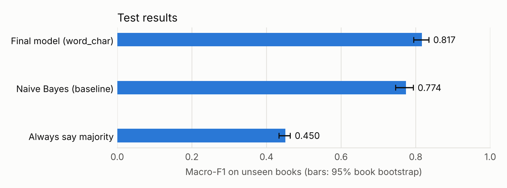
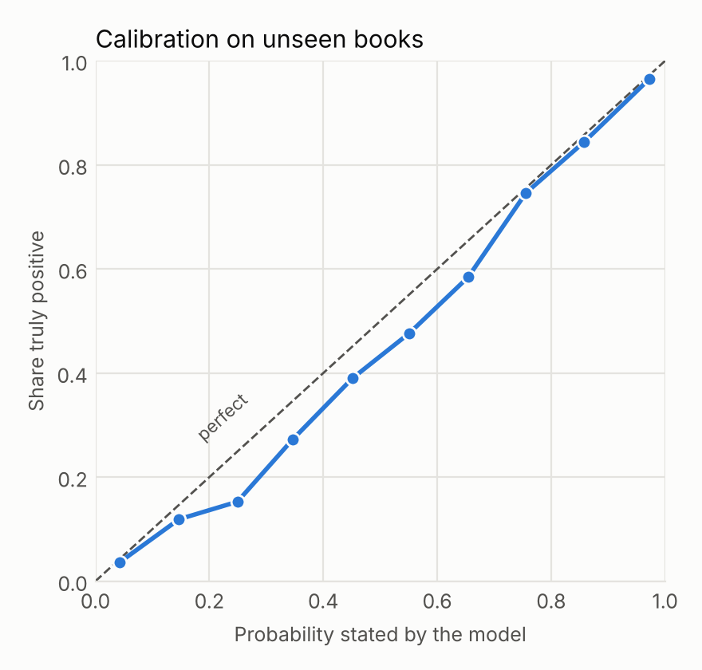
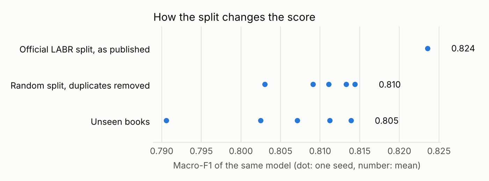

# Arabic Review Sentiment: an honest training run on LABR

Trains a small, CPU-only classifier that labels Arabic reviews as positive or
negative, using 48,274 real book reviews. The focus is on measuring it fairly:
books in the test set are never seen in training, duplicates are removed, and
the model is compared against simple baselines.

| On 7,519 reviews of 304 unseen books | Accuracy | Macro-F1 (95% interval) | Negative-class F1 |
|---|---:|---:|---:|
| Always answer "positive" | 81.9% | 0.450 (0.433 to 0.464) | 0.000 |
| Baseline: Naive Bayes on word counts | 88.0% | 0.774 (0.746 to 0.793) | 0.619 |
| **Final model: word + character TF-IDF, logistic regression** | **89.2%** | **0.817 (0.794 to 0.835)** | **0.699** |

Macro-F1 averages the score of both classes, so a model cannot look good by
only predicting the common class. The final model beats Naive Bayes by 0.043
macro-F1 (95% interval 0.032 to 0.055).

**The number to expect is about 0.805, not 0.817.** Five other book-level splits
averaged 0.805 (see below), so the single test split above was slightly easy.

## شرح المشروع بالعربي

**وش يسوي المشروع؟**
يدرّب برنامج يقرأ مراجعة مكتوبة بالعربي ويقول: هل صاحبها راضي أو غير راضي؟
اللي يهم هنا مو بس النموذج، لكن إننا نقيسه بطريقة صادقة.

**المشكلة بمثال بسيط:**
تخيل مكتبة عندها آلاف التعليقات من الزبائن، وتبي تعرف بسرعة مين الزعلانين عشان
ترد عليهم. قراءتها كلها تاخذ أيام، والبرنامج يفرزها في ثواني.
ولو واحد قال لك "نموذجي دقته 80%" فهذا مو دايم إنجاز: في بياناتنا 82% من المراجعات
إيجابية أصلاً، يعني اللي يقول "إيجابي" لكل شيء يطلع له نفس الرقم تقريباً وهو ما سوى شي!

**كيف نشغله؟**

```bash
pip install -r requirements.txt
python train.py      # ينزل البيانات ويدرّب ويطلع النتائج (حوالي 17 دقيقة على جهاز عادي)
python predict.py "الكتاب رائع وأسلوبه ممتع جدا"
```

**النتيجة:**
على كتب ما شافها النموذج أبداً، طلعت درجته 0.817 (من 1) مقابل 0.774 لطريقة بسيطة
معروفة، و0.450 للي يقول "إيجابي" دايماً. يعني أفضل بوضوح، خصوصاً في اكتشاف المراجعات
السلبية، وهي الأصعب والأهم.

واكتشفنا شي ثاني: 8% من مراجعات اختبار LABR الرسمي موجودة بنصها في بيانات التدريب،
وهذا مثل طالب شاف أسئلة الاختبار قبل، فيرفع الدرجة شوي بدون وجه حق. أما خوفنا إن النموذج
"يحفظ" أسماء الكتب فطلع تأثيره صغير جداً، وهذي نتيجة نقولها كما هي.

**وش حدوده؟** تدرّب على مراجعات كتب فقط. ما جربناه رسمياً على مطاعم أو فنادق أو تويتر،
ولا قسنا دقته على اللهجة السعودية لحالها، فلا تعتمد عليه هناك قبل ما تختبره.

## Why it is useful

- **A worked template for text models on small machines.** It runs on two CPU
  cores in about 17 minutes, with no GPU or paid API.
- **A reusable evaluation recipe.** Group-aware splits, duplicate removal,
  book-level bootstrap intervals, calibration and threshold tuning all carry
  over to other Kaggle-style text tasks.
- **Arabic-specific care.** Spelling normalization keeps negation words such as
  "لا" and "لم", which many stop-word lists would delete, because here they
  carry much of the signal.

## Install and run

Requires Python 3.10+. Run from this folder.

```bash
pip install -r requirements.txt
python -m pytest -q                       # 29 tests
python train.py                           # full run, writes results/ and artifacts/
python train.py --sample 6000 --audit-seeds 1 --out /tmp/smoke   # about 1 minute
python predict.py "رواية مملة ولا أنصح بقراءتها"
```

`train.py` downloads LABR into `data/` and refuses to continue if the SHA-256 of
`reviews.tsv` has changed. Weights are not committed; `train.py` rebuilds them
(a 19 MB file in `artifacts/`). Only load model files you trained yourself,
because joblib files can run code when loaded.

## Method

1. **Data.** Keep 1-2 stars as negative and 4-5 stars as positive; 3-star reviews
   are dropped, as in LABR's own binary task. That leaves 51,056 of 63,257 reviews.
2. **Cleaning.** Compare reviews after normalization and keep one copy of each.
   48 rows whose identical text had opposite labels are removed. 48,274 remain.
3. **Split.** Train 32,890 / validation 7,865 / test 7,519 reviews, with 1,417 / 304 /
   304 books. No book crosses a split. Reviewer ids are dropped on load.
4. **Selection on validation only.** Four feature sets (`word_raw`, `word`, `char`,
   `word_char`), each with `C` in {1, 3, 10, 30}. `word_char` with `C=10` won. See
   [`results/validation_grid.csv`](results/validation_grid.csv).
5. **Calibration and threshold on validation only.** Platt scaling, then a decision
   threshold of 0.70, chosen for macro-F1.
6. **Final fit.** Refit on train + validation, then score the test set once.
7. **Intervals.** Reviews of one book are related, so the bootstrap resamples whole
   books (2,000 draws) rather than single reviews.

## Results

Files are in [`results/`](results/); `metrics.json` holds every number below.



| Test metric | Naive Bayes | Final model |
|---|---:|---:|
| ROC-AUC | 0.864 | 0.912 |
| Brier score (lower is better) | 0.098 | 0.077 |
| Calibration error, ECE (lower is better) | 0.068 | 0.016 |

- **Threshold.** With calibrated scores, moving the cut from 0.50 to 0.70 raised
  negative-class F1 from 0.654 to 0.699, and overall accuracy fell from 89.7% to 89.2%.
- **Calibration.** ECE fell from 0.041 to 0.016, so a score of 0.9 is close to a real
  90%. The middle of the range still runs slightly optimistic.
- **Normalization.** On validation data it raised the best word-only macro-F1 from
  0.774 to 0.782.



### Does the way of splitting change the score?

The same chosen model was trained on 80% and tested on 20%, three ways.

| Split | Macro-F1 | Notes |
|---|---:|---|
| Official LABR split, as published | 0.824 | 1 split; 820 of 10,211 test reviews (8.0%) repeat text from training |
| Random split, duplicates removed | 0.810 ± 0.004 | 5 seeds |
| By book, duplicates removed | 0.805 ± 0.009 | 5 seeds, unseen books |

Duplicates account for most of the gap. We expected books shared between train
and test to inflate the score too, but that effect was only about 0.005, smaller
than the spread between seeds, so this run does not show it to be real. The
official LABR figure here is one split, so its gap is a single observation.



Scores do not simply rise with length: macro-F1 was 0.823 under 50 characters, 0.837
at 50-149, 0.795 at 150-399 and 0.818 at 400+
([`by_review_length.csv`](results/by_review_length.csv)).

## Limitations

- **Books only.** The labels come from Goodreads book reviews collected in March 2013.
  Performance on restaurants, hotels, apps or social media was not measured.
- **Dialect not measured.** The reviews mix Modern Standard Arabic and dialects, and
  there are no dialect labels, so accuracy on Saudi or Gulf Arabic is unknown.
- **Positive skew.** About 82% of test reviews are positive. Negative reviews stay
  the hard case, with F1 0.699 against 0.934 for positive ones.
- **No neutral class.** The model always picks a side. It called 69% of 1,918
  3-star test-book reviews positive.
- **Noisy labels and shortcuts.** A star rating is not always the mood of the text,
  and sarcasm is not modelled. Some reviewers write the rating in the text, so
  [`top_features.csv`](results/top_features.csv) includes phrases like "نجمتين"
  (two stars) that will not help outside review sites.
- **Linear model.** It reads word and character patterns, not meaning. Some top
  features look odd out of context; for example "الكتاب جيد" (the book is good)
  leans negative, probably because it often precedes criticism.

## Data and license

- **LABR: Large-scale Arabic Book Reviews.** Mohamed Aly and Amir Atiya, ACL 2013.
  [Repository](https://github.com/mohamedadaly/LABR), released under
  [GPL-2.0](https://github.com/mohamedadaly/LABR/blob/master/LICENSE). The raw data is
  downloaded by the code and is not stored here.
- The code in this folder is covered by the repository's MIT license. Check the
  GPL-2.0 terms of LABR before you redistribute weights trained on it.

## Project layout

```text
arsent/       normalization, data loading, splits, models, metrics
train.py      full experiment
predict.py    classify new text with the saved model
plots.py      charts
tests/        pytest suite
results/      metrics, tables and charts from the full run
```
