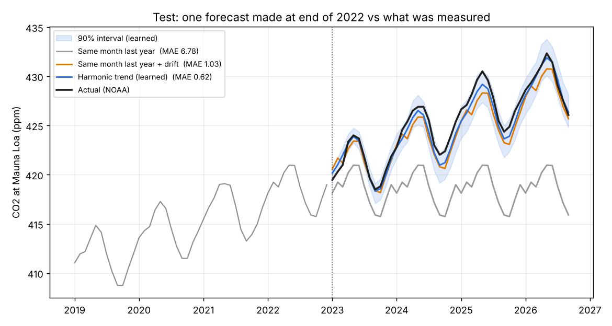
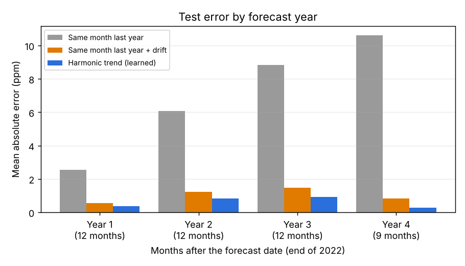
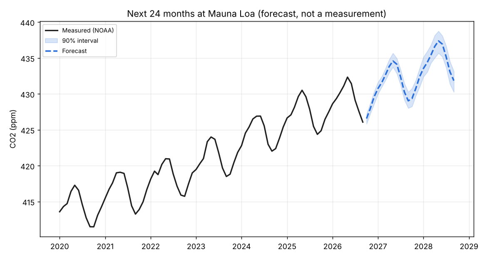

# co2-forecast: a small, honest forecaster for the Mauna Loa CO2 record

Trains and evaluates monthly forecasters for atmospheric carbon dioxide (CO2)
measured at Mauna Loa, Hawaii, the longest continuous CO2 record (1958 to
today). The project is built as a **reproducible training template for time
series**: time-ordered splits, two simple baselines, time-series
cross-validation for tuning, a test set touched once, error by forecast
horizon, and prediction intervals that are checked against what really happened.

Everything runs on a CPU in about one second and needs only `numpy`, `pandas`
and `matplotlib`.

## شرح المشروع بالعربي

**وش يسوي المشروع؟**
يتعلّم من سجل غاز ثاني أكسيد الكربون (CO2) في الجو، اللي ينقاس كل شهر في جبل
"ماونا لوا" بهاواي من سنة 1958 إلى اليوم، ويتوقع قيمته للشهور الجاية، ويعطي مع
كل توقع "مدى" (من كذا إلى كذا) بثقة 90%.

**المشكلة اللي يحلها (مثال من الحياة اليومية):**
تخيّل فاتورة الكهرباء: كل صيف ترتفع وكل شتاء تنزل، وفوق كذا كل سنة أغلى من اللي
قبلها. لو بغيت تتوقع فاتورة الصيف الجاي، ما يكفي تقول "مثل الصيف اللي فات"، لازم
تحسب الزيادة السنوية بعد. نفس الشي مع CO2: فيه تذبذب موسمي كل سنة (ينزل في الصيف
لما النباتات تمتص الكربون) وفيه ارتفاع مستمر سنة بعد سنة. المشروع يتعلّم الاثنين
مع بعض.

**كيف يشتغل؟**
1. ينزّل البيانات الرسمية (من NOAA عن طريق نسخة مفتوحة على GitHub).
2. يقسمها حسب الزمن: الماضي للتدريب، و2023 وما بعدها للاختبار النهائي فقط.
3. يقارن نموذج "متعلّم" (خط اتجاه + موجات موسمية) بطريقتين بسيطتين: "نفس الشهر
   السنة اللي فاتت"، و"نفس الشهر + متوسط الزيادة السنوية".
4. يطلع رسومات وملفات أرقام في مجلد `results/` وتوقع لـ 24 شهر جاية.

**كيف أشغله؟**
```bash
cd models/co2-forecast
pip install -r requirements.txt
python train.py          # ينزّل البيانات ويطلع النتائج في results/
python -m pytest -q      # يشغّل الاختبارات
```

**النتيجة الرئيسية:**
لو وقفنا في آخر 2022 وتوقعنا 45 شهر قدام (إلى سبتمبر 2026)، كان متوسط خطأ
النموذج المتعلّم **0.62 جزء من المليون (ppm)**، يعني أقل من سُبع واحد بالمية من
القيمة. أفضل طريقة بسيطة غلطت **1.03 ppm**، فالنموذج قلّل الخطأ تقريباً **40%**.
والمدى (90%) احتوى القيمة الحقيقية في 42 شهر من 45. وللأمانة: في نافذة واحدة
(2020–2022) الطريقة البسيطة كانت أحسن، والنموذج عموماً توقّع أقل شوي من الواقع
لأن الزيادة في 2023–2024 كانت أسرع من المعتاد.

## Why it is useful

* **A template you can copy.** Most forecasting tutorials shuffle data, tune
  on the test set, or skip baselines. This one shows the minimum honest
  protocol in ~300 lines that you can lift into a Kaggle time-series notebook.
* **Baselines that are hard to beat.** "Same month last year + drift" is a
  strong baseline for any series with a trend and a yearly cycle (sales,
  electricity demand, temperatures). The project shows how to measure whether a
  learned model actually beats it, and over which horizons.
* **Checked uncertainty.** Prediction intervals come from the model's own past
  forecast errors and are then checked on unseen data.
* **Real, public, important data**, updated monthly, so the whole pipeline can
  be re-run later and the forecast compared with new measurements.

## Install and run

```bash
cd models/co2-forecast
pip install -r requirements.txt
python train.py                      # downloads the CSV (~40 KB) and writes results/
python train.py --data my_copy.csv   # or use a local copy of the same CSV
python -m pytest -q                  # 12 tests
```

Library use:

```python
from co2fc import load, HarmonicTrend
y = load()["co2"]                                  # pandas Series, monthly PeriodIndex
m = HarmonicTrend(degree=2, harmonics=2, window_years=30, anchor_months=6).fit(y)
print(m.predict(12))                               # next 12 months, ppm
```

The models work on any monthly series with a `PeriodIndex`.

## Data

| Item | Value |
|---|---|
| Measurements | NOAA Global Monitoring Laboratory, Mauna Loa monthly mean CO2 ([trends page](https://gml.noaa.gov/ccgg/trends/)) |
| File used | [`datasets/co2-ppm` `data/co2-mm-mlo.csv`](https://github.com/datasets/co2-ppm) on GitHub (Frictionless Data mirror of NOAA's `co2_mm_mlo.txt`) |
| License | Mirror: [ODC-PDDL-1.0](https://opendatacommons.org/licenses/pddl/) (public domain). NOAA asks users to cite the data: Lan, X., Tans, P. and K.W. Thoning, *Trends in globally-averaged CO2 determined from NOAA Global Monitoring Laboratory measurements*, NOAA GML. |
| Coverage in this run | 1958-03 to 2026-09, 823 months, no gaps |
| Caveats | 195 early months (mostly 1958–1970s) have no daily count and were filled by NOAA by interpolation; the mirror's header row lists fewer column names than the data has, so `co2fc/data.py` reads columns by position, following NOAA's layout. The data is downloaded at run time and not committed. |

## Method

| Step | What happens |
|---|---|
| Split (time-ordered) | train 1958-03..2019-12, validation 2020-01..2022-12, test 2023-01..2026-09 (45 months) |
| Baseline 1 | `seasonal_naive`: next value = same month last year |
| Baseline 2 | `seasonal_naive_drift`: same month last year + average 12-month change over the last *k* years (*k* tuned) |
| Learned model | `harmonic_trend`: least-squares fit of a polynomial trend (degree 1–3) + 1–4 yearly Fourier harmonics on the last 10/15/20/30 years or all data, with an optional intercept correction (`anchor_months`) that starts the forecast from the recent residual level. 240 configurations. |
| Tuning | time-series cross-validation on train+validation only: 59 forecast origins every 6 months from 1990-12 to 2019-12, each forecasting 36 months ahead; parameters with the lowest mean absolute error win. Baselines are tuned the same way. |
| Test | each tuned model is refitted on train+validation and makes **one** 45-month forecast from 2022-12 |
| 90% intervals | empirical 5th/95th percentiles of the learned model's past errors at each horizon (57 backtest origins inside train+validation), added to the forecast; coverage then checked on the test window |
| Future | refit on all data, forecast 2026-10..2028-09 with intervals from 68 backtest origins |

Chosen parameters: `harmonic_trend` degree 2, 2 harmonics, last 30 years,
anchor over the last 6 months; drift baseline uses the last 10 years.

## Results (measured in this run)

Test window 2023-01..2026-09, one forecast made at the end of 2022:

| Model | Test MAE (ppm) | Test RMSE (ppm) | Test MAPE | CV MAE, 36-month horizon (ppm) |
|---|---|---|---|---|
| Same month last year | 6.78 | 7.43 | 1.59% | 4.04 |
| Same month last year + drift | 1.03 | 1.19 | 0.24% | 0.75 |
| **Harmonic trend (learned)** | **0.62** | **0.74** | **0.15%** | **0.62** |

* The learned model has **40% lower test MAE** than the best baseline, and
  lower error in every forecast year (year 1: 0.36 vs 0.55 ppm; year 3: 0.92 vs 1.48 ppm).
* Its 90% intervals contained the measured value in **42 of 45** test months (93%).
* Forecast for the next 24 months (`results/forecast_next24.csv`): the yearly
  peak should reach about **434.6 ppm in May 2027** (90% interval 433.7–435.7)
  and **437.4 ppm in May 2028** (435.7–438.8). These are model forecasts, not measurements.





Files in `results/`: `metrics.json` (all numbers above), `tuning.csv` (every
configuration and its CV error), `test_predictions.csv`, `forecast_next24.csv`
and the three charts.

## Honest limitations

* **The single 2020–2022 validation window disagrees.** Forecasting 2020–2022
  from the end of 2019, the drift baseline was better (MAE 0.29 vs 0.48 ppm).
  The learned model wins on the 59-origin cross-validation and on the test, but
  the margin depends on the period. A single test origin is one draw, not a
  guarantee.
* **CV error of the learned model is slightly optimistic**: it is the best of
  240 configurations, while the drift baseline chose among 4.
* **Development history, for transparency:** a first version tuned on the one
  2020–2022 window only (no anchor option) reached a test MAE of 0.67 ppm. It
  was replaced by cross-validated tuning because one window is too noisy to tune
  on; the test numbers above are from the cross-validated version.
* **Bias:** on the test the model under-predicted on average by 0.47 ppm,
  because CO2 grew unusually fast in 2023–2024. It extrapolates the past
  30-year curve and knows nothing about El Niño, emissions or policy, so it is
  not a climate model and should not be used for long horizons.
* **One station.** Mauna Loa is a reference site; local CO2 elsewhere
  (for example in a city) behaves differently.

## Layout

```
co2fc/data.py      download + parse (by column position) + gap check
co2fc/models.py    SeasonalNaive, SeasonalNaiveDrift, HarmonicTrend
co2fc/evaluate.py  metrics, split, rolling-origin CV, empirical intervals
train.py           the full protocol; writes results/
plots.py           the three charts
tests/             12 pytest tests (synthetic series, labelled as such, + an end-to-end run)
```

License: MIT (same as the repository).
