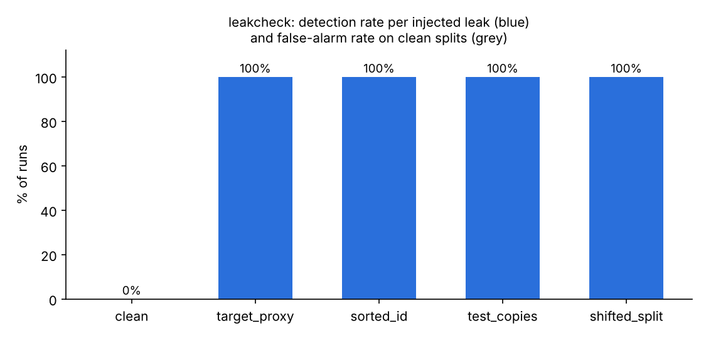

# leakcheck: catch data leakage before it fools your validation score

`leakcheck` is a small Python library and command-line tool that audits a train/test pair
(or a single training table) for the most common kinds of **data leakage**: problems that make
a model look much better in validation than it will be on new data.

It runs in seconds on CPU, needs only `numpy`, `pandas` and `scikit-learn`, and prints a
Markdown report you can paste into a notebook, a Kaggle discussion or a pull request.
With `--fail-on high` it can also stop a CI pipeline.

## شرح المشروع بالعربي

**وش هو؟** أداة بايثون صغيرة تفحص بيانات التدريب والاختبار قبل ما تدرّب أي نموذج، وتدوّر على "التسريب"
(Data Leakage). التسريب يعني إن النموذج يشوف بالغلط معلومة ما راح تكون موجودة وقت الاستخدام الحقيقي،
فتطلع نتيجته في التجربة عالية جدًا، وإذا استخدمته فعلًا تطيح النتيجة.

**مثال من الحياة:** تخيّل طالب يذاكر للاختبار، وبالغلط بعض أسئلة الاختبار كانت موجودة بنفس نصها في
بنك الأسئلة اللي ذاكر منه. بيجيب درجة كاملة، بس هذا ما يعني إنه فاهم المادة. نفس الشي مع النماذج:
لو صفوف من بيانات الاختبار منسوخة في بيانات التدريب، أو فيه عمود "يفضح" الإجابة (مثلًا عمود محسوب من
النتيجة نفسها)، النموذج يطلع ممتاز على الورق وضعيف في الواقع. هذي مشكلة مشهورة في مسابقات Kaggle.

**وش تفحص الأداة؟**
- صفوف في الاختبار منسوخة من التدريب.
- عمود لحاله يتوقع الإجابة تقريبًا 100% (غالبًا هذا تسريب).
- أعمدة رقم تعريفي (ID) مرتبة بطريقة تكشف الإجابة.
- هل بيانات الاختبار شكلها مختلف عن التدريب؟ (ندرّب نموذج يحاول يفرّق بينهم؛ لو قدر بسهولة، فيه اختلاف).
- نفس الشخص/المجموعة موجود في الجهتين، أو بيانات من المستقبل داخلة في التدريب.

**كيف أشغّلها؟**
```bash
pip install -r requirements.txt
python -m leakcheck train.csv --test test.csv --target label --md report.md
```
وتطلع لك قائمة ملاحظات مرتبة حسب الخطورة: high (خطير)، medium (يستاهل نظرة)، low، info.

**النتيجة:** جرّبنا الأداة على 4 مجموعات بيانات حقيقية من مكتبة scikit-learn، وزرعنا فيها بأنفسنا 4 أنواع
تسريب معروفة (وكتبنا بوضوح إنها مزروعة). على 160 تجربة فيها تسريب لقطت الأداة التسريب في كل مرة (100%)،
وعلى 40 تجربة نظيفة ما أعطت ولا إنذار كاذب واحد (0%). هذي أرقام على بيانات صغيرة ونظيفة؛ في الواقع ممكن
تعطي إنذار لعمود قوي فعلًا وهو مو تسريب، فالقرار الأخير لك.

## Why it is useful

Leakage is one of the most common reasons a model that scored well offline fails in production,
and a classic trap in Kaggle competitions (duplicated rows across splits, IDs that encode the label,
features computed from the target, test sets that come from a different distribution).
Most people check for it by hand, if at all. `leakcheck` turns a set of standard checks into one
function call with clear, ranked findings.

## What it checks

| Check | Question it answers | Needs |
|---|---|---|
| `cross_duplicates` | Do test rows have exact copies in train? | test |
| `train_duplicates` | Are train rows repeated, so plain KFold puts copies in different folds? | train |
| `conflicting_labels` | Do identical rows carry different labels? (info) | target |
| `id_like_column` | Is a column unique per row (an ID)? Does it also predict the target? | train |
| `target_leakage` | Does a single column predict the target almost perfectly by itself? | target |
| `adversarial_validation` | Can a model tell train rows from test rows? Which columns shift most? | test |
| `group_overlap` | Do the same groups (patients, users, stores) appear in train and test? | `--group` |
| `time_overlap` | Are test rows not strictly later than train rows? | `--time` |

How the main checks work:

- **Single-column scores** use a small decision tree (32 leaves max) that sees one column at a
  time, scored out-of-fold with 3-fold CV: AUC and balanced accuracy for classification, R² for
  regression. A column is flagged at AUC ≥ 0.98 or balanced accuracy ≥ 0.96 (medium) and
  AUC ≥ 0.995 or balanced accuracy ≥ 0.99 (high); for regression at R² ≥ 0.93 / 0.98.
  Trees handle missing values and categorical codes, so non-linear lookups are caught too.
- **Adversarial validation** trains a `HistGradientBoostingClassifier` to predict "is this row from
  test?" with 3-fold CV. AUC ≥ 0.65 is medium and ≥ 0.80 high, but only if the AUC is also at least
  3 standard errors above 0.5 (Hanley-McNeil), so tiny test sets do not raise alarms from noise.
- **Duplicates** compare row hashes over all feature columns. If fewer than half of the train rows
  are distinct (for example three categorical columns), repeats are expected and the severity is
  lowered with a note.

All thresholds live in `leakcheck.Thresholds` and can be changed.

## Install and run

```bash
cd tools/leakage-check
pip install -r requirements.txt
```

Command line:

```bash
python -m leakcheck train.csv --test test.csv --target label \
    --group customer_id --time date --md report.md --json report.json --fail-on high
```

Python:

```python
import pandas as pd
from leakcheck import audit

train, test = pd.read_csv("train.csv"), pd.read_csv("test.csv")
report = audit(train, test, target="label")
print(report.to_markdown())
for f in report.at_least("medium"):
    print(f.check, f.severity, f.details)
```

`test` may be `None` (train-side checks only) and does not need the target column.
Large tables are randomly subsampled to `max_rows=20000` per side for speed.

Reproduce the results in this folder:

```bash
python -m pytest -q tests     # 17 tests
python benchmark.py           # ~3.5 min on CPU -> results/benchmark.{csv,md,png}
python titanic_case.py        # downloads a small CSV from GitHub -> results/titanic_report.{md,json}
```

## Results

### Benchmark with injected leaks (`results/benchmark.md`)

Four real datasets that ship with scikit-learn: breast_cancer (569 rows), wine (178),
digits (1,797) and diabetes (442, regression). For each dataset and 10 random seeds we build
five train/test pairs: a clean random 75/25 split, and four versions with a leak **deliberately
injected** by us so the right answer is known:

- `target_proxy`: a column copied from the target with 3% of values replaced at random
  (regression: target + noise with 10% of its standard deviation);
- `sorted_id`: rows sorted by target, then a `row_id` column added;
- `test_copies`: 10% of train rows copied into test;
- `shifted_split`: test = the top 25% of rows on one random feature.



| Scenario | Detected (medium or high) | False alarms from other checks | Runs |
|---|---|---|---|
| clean | - | 0% | 40 |
| target_proxy | 100% | 0% | 40 |
| sorted_id | 100% | 0% | 40 |
| test_copies | 100% | 0% | 40 |
| shifted_split | 100% | 0% | 40 |

Mean audit time: about 0.3 to 2.6 s per pair (digits, 64 columns, is the slowest).

**Honest note on tuning.** The balanced-accuracy rule and the 3-standard-error rule were added
after a first run on seeds 0-9, which had one miss (a noisy target proxy on wine) and one false
alarm (adversarial AUC 0.67 on a 45-row wine test set). The table above uses fresh seeds 100-109
that were not looked at while tuning. Even so, these are small, clean datasets and synthetic
leaks; real leaks can be subtler.

### Real-data case study: Titanic (`results/titanic_report.md`)

A plain random split of the 1,309-passenger Titanic table (sex, age, class; names dropped),
with no injected leak. `leakcheck` reports that 87% of test rows have exact copies in train,
but because only 31% of train rows are distinct it marks this as natural to the data
(medium, with a note) instead of high, reports 68 groups of identical rows with different
outcomes (label noise / missing information), and finds no train/test shift
(adversarial AUC 0.51). No column is flagged as target leakage (best single column: sex, AUC 0.74).

## Limitations

- **A strong feature is not always a leak.** On the iris dataset the petal measurements reach
  single-column AUC ≈ 0.98 and are flagged *medium*. The tool cannot know when a value becomes
  available; you decide. Use `ignore=[...]` or raise the thresholds once you have checked.
- Single-column checks miss leaks that are only visible in **combinations** of columns
  (e.g. `price_total / quantity`), and proxies that agree with the label less than ~96% of the time.
- Duplicate detection is **exact** (after converting values to strings); rounded or re-scaled
  copies are not matched.
- Adversarial validation tells you *that* train and test differ, not whether it matters for your
  model.
- Text, image and time-series leaks (e.g. overlapping windows) are out of scope.

## Data sources and licenses

- scikit-learn bundled datasets (breast cancer, wine, digits, diabetes; originally from the UCI
  Machine Learning Repository and Efron et al. 2004), distributed with scikit-learn under the
  BSD-3-Clause license: <https://scikit-learn.org/stable/datasets/toy_dataset.html>.
- Titanic passenger data, `TitanicSurvival` from the R package **carData** (GPL-2 | GPL-3),
  read from the Rdatasets mirror: <https://github.com/vincentarelbundock/Rdatasets>.
  The CSV is downloaded at run time and not stored in this repository; the passenger-name column
  is dropped immediately and never used.

## Project layout

```
leakcheck/        library (core.py) and CLI (cli.py, python -m leakcheck)
tests/            pytest suite
benchmark.py      injected-leak benchmark on scikit-learn datasets
titanic_case.py   real-data case study
results/          outputs produced by the two scripts above
```

Code license: MIT, same as the repository.
