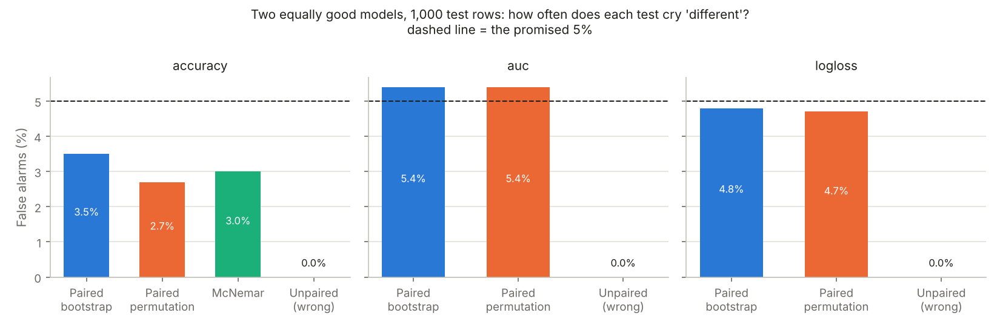
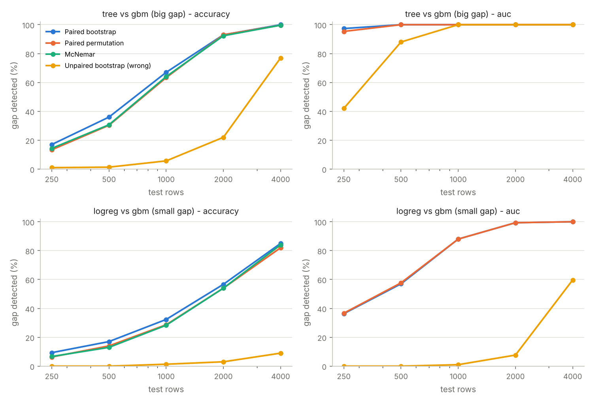
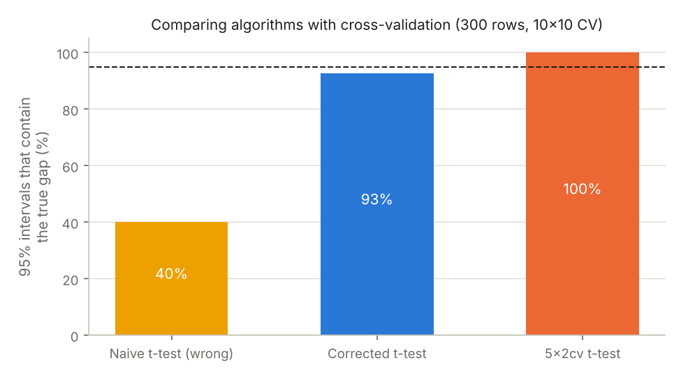

# sigdiff: is model B really better, or is it just luck?

You trained a new model. On the test set it scores 0.875 accuracy and the old one
scores 0.857. Is the new one better, or did it just get a lucky test set?

`sigdiff` answers that question with **paired** significance tests and confidence
intervals for comparing two (or more) machine learning models on the same test
set or on the same cross-validation folds. It is a small Python library plus a
command line tool, with a benchmark on real data that checks the tests keep their
promises.

```text
$ python -m sigdiff compare results/example_predictions.csv --target y --a logreg --b gbm --metric auc
auc (higher is better), n=1000
  logreg: 0.90275
  gbm: 0.91303
  gbm - logreg: +0.01027  [95% CI +0.00096, +0.02042]
  p-value (bootstrap): 0.03
  verdict: gbm is better (p=0.03 < 0.05)
```

## شرح المشروع بالعربي

**وش يسوي المشروع؟**
لما تسوي نموذج ذكاء اصطناعي جديد وتقارنه بالقديم، غالباً تشوف فرق بسيط في النتيجة،
مثلاً القديم دقته 85.7% والجديد 87.5%. السؤال المهم: هل الجديد فعلاً أحسن، ولا الفرق
مجرد حظ لأن أسئلة الاختبار جت في صالحه؟ هذي الأداة تجاوب على هالسؤال بالأرقام.

**مثال من الحياة:** طالبين حلوا نفس الاختبار من 20 سؤال، واحد جاب 17 والثاني 18.
ما تقدر تقول إن الثاني أذكى، لأن سؤال واحد ممكن يكون حظ. لكن لو الاختبار 2000 سؤال
والفرق ثابت، هنا الفرق حقيقي. الأداة تحسب "كم الفرق اللي ممكن يجي بالحظ" وتقول لك
هل الفرق اللي شفته أكبر منه ولا لا. وتنفع كثير في مسابقات Kaggle، لأن تحسن صغير في
لوحة النتائج كثير مرات يكون حظ مو تحسن حقيقي.

**كيف يشتغل؟**
- تعطيه ملف فيه الإجابات الصحيحة وتوقعات النموذجين على نفس الصفوف.
- يعيد "سحب" صفوف الاختبار آلاف المرات (bootstrap: يعني نسوي اختبارات وهمية من نفس
  البيانات) ويشوف كم يتغير الفرق بين النموذجين.
- يطلع لك الفرق، ومدى الثقة فيه (مثلاً: الفرق بين +0.1% و +2%)، وحكم واضح: "B أحسن"
  أو "ما فيه فرق مؤكد".
- وفيه أدوات للمقارنة بالـ cross-validation (تقسيم البيانات لأجزاء وتدريب واختبار
  متكرر) لأن الطريقة المعتادة فيها خطأ شائع.

**النتيجة الرئيسية (مقاسة على بيانات حقيقية):**
- لما يكون النموذجين متساويين فعلاً، الأداة تقول "فيه فرق" بالغلط في 2.7% إلى 5.4% من
  المرات، وهذا ضمن الـ 5% الموعودة تقريباً.
- مع 1000 صف اختبار، نموذجين متساويين ممكن يختلفون بالحظ لين 1.4 نقطة مئوية في
  الدقة. يعني أي تحسن أقل من كذا لا تفرح فيه قبل تتأكد.
- الطريقة الشائعة الغلط في cross-validation (اختبار t العادي) قالت "فيه فرق" في 59% من
  المرات مع إن الفرق الحقيقي شبه صفر، والطريقة المصححة في الأداة قالتها 6% بس.

**التشغيل:**
```bash
pip install -r requirements.txt
python -m sigdiff compare ملف_التوقعات.csv --target y --a القديم --b الجديد --metric accuracy
```

## Why this is useful

* Kaggle leaderboards, paper tables and A/B model reviews are full of "improvements"
  that are smaller than the noise of the test set. On our benchmark, two equally good
  models on a 1,000-row test set differ by up to **1.4 accuracy points** just by chance
  (95th percentile).
* The most common shortcut, comparing two scores as if they came from independent test
  sets, throws away the pairing and is **far too timid**: it missed a real 1.1-point
  accuracy gain in 99% of 1,000-row test sets, where the paired tests found it a third
  of the time and the AUC version of the same gap in 88%.
* The most common cross-validation shortcut, a plain t-test on fold scores, is
  **far too bold**: it declared a winner in 59% of runs where the true gap was ~0.
  The Nadeau-Bengio corrected test in `sigdiff` did so in 6%.

## What's inside

| Function | Use it when |
|---|---|
| `compare(y, pred_a, pred_b, metric)` | two models, one test set: difference, 95% CI, p-value, verdict |
| `compare_many(y, {name: pred}, baseline, metric)` | many models vs a baseline, Holm-corrected so "lucky winners" don't slip through |
| `paired_bootstrap(...)` | CI and p-value by resampling test rows (same rows for both models) |
| `permutation_test(...)` | exact-style test by randomly swapping the two models' predictions per row |
| `mcnemar(...)` | classic exact test for accuracy of two classifiers |
| `corrected_resampled_ttest(scores_a, scores_b, n_train, n_test)` | (repeated) k-fold CV fold scores |
| `five_by_two_cv_ttest(scores_a, scores_b)` | Dietterich's 5x2cv design |
| `naive_ttest(...)` | included only to show why you should not use it on CV folds |
| `holm(pvalues)` | Holm-Bonferroni adjustment |

Metrics: `accuracy`, `auc`, `f1`, `logloss`, `brier` (binary classification;
pass labels or probabilities of class 1) and `mae`, `mse`, `rmse`, `r2`
(regression). `groups=` resamples whole clusters (e.g. all rows of one customer
or one day) when rows are not independent.

The core library needs only numpy and scipy (pandas for the CLI).

## Install and run

```bash
cd tools/model-compare
pip install -r requirements.txt        # or: pip install .
python -m pytest -q                    # 18 tests
```

Python:

```python
import sigdiff as sd

res = sd.compare(y_test, proba_old, proba_new, metric="auc", name_a="old", name_b="new")
print(res.summary())          # difference, 95% CI, p-value, verdict
res.to_dict()                 # for logging

# several candidates vs a baseline, Holm-corrected
for r in sd.compare_many(y_test, {"base": p0, "xgb": p1, "mlp": p2}, baseline="base", metric="logloss"):
    print(r.name_b, r.verdict)

# cross-validation: per-fold scores from the SAME folds for both models
r = sd.corrected_resampled_ttest(fold_scores_a, fold_scores_b, n_train=900, n_test=100)
```

CLI:

```bash
python -m sigdiff compare preds.csv --target y --a old --b new --metric accuracy --method mcnemar
python -m sigdiff compare preds.csv --target y --a base --b m1,m2,m3 --metric logloss   # Holm-corrected
python -m sigdiff compare preds.csv --target y --a old --b new --metric mae --groups customer_id
python -m sigdiff cv folds.csv --a old --b new --n-train 900 --n-test 100
```

Add `--json` for machine-readable output. See `results/example_cli_output.txt`.

## Benchmark: do the tests keep their promises?

`python benchmark/run_benchmark.py` (about 27 minutes on 2 CPUs; `--quick` for a
1-minute smoke run) uses the real **UCI Adult** census-income data (48,842 rows,
predict income > 50K). Protected attributes (race, sex, native country) and the
sampling weight are dropped; the benchmark is about statistics, not about people.
8,000 rows train three models (logistic regression, a depth-3 decision tree,
gradient boosting); a 30,842-row pool plays the role of "the whole world", so the
true gap between two models is known.

Pool scores: logistic regression 0.8512 acc / 0.9044 AUC; tree 0.8440 / 0.8634;
gradient boosting 0.8624 / 0.9187.

### 1. False alarms when the models are equally good

For each of 1,000 random 1,000-row test sets we swap the predictions of two real
models row by row at random, which makes the two "models" exactly equally good in
expectation. A 5%-level test should then cry "different" about 5% of the time
(±1.4 points of simulation noise).

| metric | paired bootstrap | permutation | McNemar | unpaired bootstrap |
|---|---|---|---|---|
| accuracy | 3.5% | 2.7% | 3.0% | 0.0% |
| AUC | 5.4% | 5.4% | n/a | 0.0% |
| log loss | 4.8% | 4.7% | n/a | 0.0% |



All paired tests are at or slightly below the promised 5%. (Accuracy is discrete, so
the tests are a little conservative there.)

**How big can a lucky gap be?** 95th percentile of the accuracy gap between two
equally good models (`results/noise_floor_accuracy.csv`):

| test rows | 250 | 500 | 1,000 | 2,000 | 4,000 | 10,000 |
|---|---|---|---|---|---|---|
| lucky gap (accuracy points) | 2.8 | 2.0 | 1.4 | 1.05 | 0.73 | 0.47 |

### 2. Detecting real gaps, and interval coverage

Two real pairs: tree vs boosting (true gap +1.8 accuracy points, +0.055 AUC) and
logistic regression vs boosting (+1.1 points, +0.014 AUC). 300 test sets per size.
"Detected" = p < 0.05. Full table: `results/power_and_coverage.csv`.

| pair, metric | test rows | paired bootstrap | permutation | McNemar | unpaired | 95% CI coverage |
|---|---|---|---|---|---|---|
| logreg vs gbm, accuracy | 1,000 | 32% | 29% | 28% | 1% | 93% |
| logreg vs gbm, accuracy | 4,000 | 85% | 82% | 84% | 9% | 96% |
| logreg vs gbm, AUC | 1,000 | 88% | 88% | n/a | 1% | 94% |
| logreg vs gbm, log loss | 1,000 | 96% | 95% | n/a | 0.3% | 96% |
| tree vs gbm, accuracy | 1,000 | 67% | 63% | 64% | 6% | 95% |
| tree vs gbm, AUC | 250 | 97% | 95% | n/a | 42% | 95% |



Takeaways: pairing matters enormously; AUC and log loss detect the same real
improvement with far fewer test rows than accuracy; and the bootstrap intervals
contained the true gap 93-97% of the time for accuracy and AUC at every size.

### 3. Cross-validation

300 simulated studies, each with 300 rows, comparing logistic regression with a
depth-4 tree by 10x10-fold CV (and 5x2cv). The true expected gap (from 400
independent training sets scored on 10,000 held-out rows) is −0.21 points (standard error 0.09),
i.e. essentially zero.

| test | 95% interval contains the truth | declared a winner (p < 0.05) |
|---|---|---|
| naive paired t-test on fold scores | 40% | 59% |
| corrected resampled t-test (Nadeau-Bengio) | 93% | 6% |
| 5x2cv t-test (Dietterich) | 100% | 3% |



The naive test is badly over-confident because CV folds share training data and
repeated CV re-uses every test row. The corrected test is close to nominal; 5x2cv
is safe but its interval (a heuristic in this library) is about twice as wide.

## Honest limitations

* **Log loss with over-confident models.** The depth-3 tree outputs probabilities of
  exactly 0 or 1 on some leaves. Six rows in the 30,842-row pool where it is
  confidently wrong cost 34.5 nats each and dominate the true log-loss gap. Most test
  sets do not contain them, so for tree vs boosting the log-loss interval covered the
  true gap only 82-89% of the time at 1,000-4,000 rows. No resampling method can see
  rows that are not in your test set: if per-row losses are extremely heavy-tailed,
  clip probabilities or report a robust metric too.
* Percentile bootstrap intervals are approximate for small test sets (a few hundred
  rows) and for non-smooth metrics; the permutation test is the safer p-value there.
* A significant difference is not the same as an important one. Always look at the
  size of the interval, not only the p-value.
* The tests answer "is B better on data like this test set?". They cannot detect
  distribution shift or leakage (see `tools/leakage-check` for that).
* Cross-validation tests compare *algorithms* (training procedures), not two fixed
  trained models. The CV experiment uses one dataset, one model pair and one size.
* Multiclass probability matrices are not supported yet; pass predicted labels for
  accuracy, or one-vs-rest scores per class.
* The benchmark took about 1,600 seconds on 2 CPUs; all numbers above come from it
  (`results/summary.json`). Results are seeded: a second full run reproduced every number exactly.

## Data sources and licenses

* **UCI Adult** (Becker & Kohavi, 1996), https://archive.ics.uci.edu/dataset/2/adult,
  license **CC BY 4.0**. Downloaded at run time from the public mirror
  https://raw.githubusercontent.com/jbrownlee/Datasets/master/adult-all.csv and not
  committed, except `results/example_predictions.csv` (1,000 test labels with three
  models' predicted probabilities, derived from the CC BY 4.0 data).
* Method references: Efron & Tibshirani (1993) bootstrap; McNemar (1947);
  Dietterich (1998) "Approximate statistical tests for comparing supervised
  classification learning algorithms"; Nadeau & Bengio (2003) "Inference for the
  generalization error"; Holm (1979).

Code: MIT, same as the repository.

## Files

```
sigdiff/            library (metrics.py, paired.py, cv.py, compare.py, cli.py)
tests/              pytest suite
benchmark/          run_benchmark.py (experiments + charts), example_cli.py
results/            summary.json, CSV tables, raw simulation results (.csv.gz), charts, example predictions and CLI output
```
